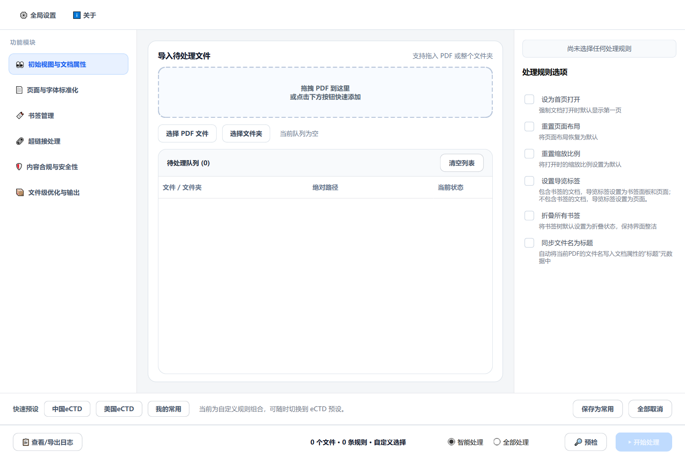

# RATools-for-PDF

专为 RA 递交场景开发的桌面端 PDF 批量处理工具，适用于 eCTD 资料整理、合规清理和结构标准化。

项目基于 `PySide6` 构建图形界面，基于 `PyMuPDF` 实现 PDF 底层处理，并使用 `qpdf` 完成版本转换、线性化与权限限制解除等结构级优化。项目源码采用 `GNU AGPL v3`，第三方组件声明见 `THIRD_PARTY_NOTICES.md`。

当前源码版本：`v0.8.3`。本版新增选择性去水印、功能模块与规则搜索，优化预览、界面字体和“加密与解密”弹窗；完整变更见 [CHANGELOG.md](CHANGELOG.md)。

**[下载软件](https://github.com/PharmaRA/RATools-for-PDF/releases) · [完整使用手册](docs/manual/index.md) · [第一次处理 PDF](docs/manual/quick-start.md) · [全部功能索引](docs/manual/feature-index.md)**



截图来自较早版本，用于展示主要区域；当前按钮和菜单位置见[认识主窗口](docs/manual/interface.md)。

## 开始使用

1. 按[安装与更新](docs/manual/installation.md)完整解压 Windows 发布包，运行对应 EXE。
2. 添加 PDF 工作副本，保持默认另存，先运行只读预检。
3. 选择规则或预设，点击“开始处理”，选择输出位置并审阅处理计划。
4. 打开实际输出复核内容，再按需保存日志及最近批次审计包。

使用手册逐项说明七个模块、42 条规则及独立工具的入口、操作步骤、保存位置和限制。可直接阅读[常见工作流程](docs/manual/workflows.md)，或按问题查阅[排错指南](docs/manual/faq.md)。

## 项目导航

- 安装、逐项功能与场景教程：[完整使用手册](docs/manual/index.md)
- 带搜索的手册网站与本地预览：[Starlight 文档站](docs/docs-site.md)
- 当前入口、稳定状态与验收边界：[能力矩阵](docs/capabilities.md)
- 按使用目的查找说明：[文档首页](docs/README.md)
- 使用问题与已知限制：[FAQ.md](FAQ.md)
- 贡献说明：[CONTRIBUTING.md](CONTRIBUTING.md)
- 版本记录：[CHANGELOG.md](CHANGELOG.md)

## 项目特性

- 面向 RA / eCTD 场景的 PDF 批量处理桌面工具
- 支持功能模块与规则实时搜索、多词匹配和高亮定位
- 支持拖拽导入 PDF 文件或整个文件夹，并自动递归收集 PDF
- 内置中国 eCTD、美国 eCTD 两套快速预设，并支持保存“我的常用”规则组合
- 支持批量处理并保留原始目录层级输出
- 支持批量预检 PDF 状态，自动提示建议处理项
- 支持通过“文档检测”模块按钮，只读扫描队列中的批注与 Word 转 PDF 失效引用/链接文本
- 支持处理中停止整批任务、串行跳过当前文件、并行终止选中文件，或仅重试上一轮失败项
- 支持在全局设置中启用并行处理并配置并行数量；并行模式下可终止选中的正在处理文件
- 支持仅处理预检中发现建议项的文件
- 支持处理日志查看、筛选、搜索与导出，便于复核处理结果
- 开始处理前先预览计划，输出保存后重开并检查结构，再发布结果
- 支持版本化配置导入/导出、差异预览与最近已结束批次审计包
- 支持设置每文件超时；规则结果分别记录选择、执行、实际变化与有限后置检查
- 支持预检结果导出为 CSV
- 提供独立去水印工具，支持对象筛选、跨页同款批量选择、前后预览与另存新 PDF
- 支持书签、超链接的批量导出与批量导入
- 书签与超链接导入导出时可保留相对目录层级，避免同名 PDF 数据互相覆盖
- 支持默认输出目录、自动打开输出目录与覆盖原文件风险控制
- 支持在“关于”中手动检查 GitHub Releases 更新
- 支持对重大更新进行启动提醒，并提供无更新能力的 `NoUpdate` 发布变体

## 当前支持的核心能力

### 1. 初始视图与文档属性

- 设为首页打开
- 重置页面布局
- 重置缩放比例
- 设置导览标签（有书签时显示书签面板）
- 折叠所有书签
- 根据文件名自动写入 PDF 标题属性

### 2. 页面与字体标准化

- 批量转换页面为 A4
- 批量转换页面为 Letter
- 字体风险预检、外部程序手动处理与保存后复检（自动嵌入仍不可用）
- PDF 版本转换
- 启用线性化（快速网页浏览）

密码和权限操作使用主窗口的“加密与解密”，不属于主界面的批量规则；见下文“加密与解密及隐藏工作台”。

### 3. 书签管理

- 书签设为承前缩放
- 书签动作改为新窗口打开
- 删除书签中的外部链接
- 删除失效书签
- 删除未知动作书签
- 书签批量导出为 CSV
- 从 CSV 批量导入书签

### 4. 超链接处理

- 将外部文件链接的绝对路径转为相对路径
- 超链接设为承前缩放
- 超链接动作改为新窗口打开
- 链接文本设为蓝色
- 增加或删除链接边框
- 统一有框/无框蓝字链接样式
- 超链接批量导出为 JSON
- 从 JSON 批量导入超链接

### 5. 内容合规与安全性

- 删除外部 URI 链接
- 删除外部 URI 链接并将文字改为黑色
- 删除失效或无效链接
- 删除失效或无效链接并将文字改为黑色
- 删除未知动作链接
- 删除 JavaScript、3D 或动态内容
- 删除文档附件
- 删除文档标签
- 删除 PDF 注释
- 删除文档元数据
- 一键删除所有链接和书签

### 6. 文件级优化与输出

- 按 eCTD 规则规范化输出文件名
- 处理完成后自动打开输出目录
- 可选覆盖原始文件（高风险操作）
- 批量输出到 `RATools_Output` 目录

### 7. 批处理控制与日志

- 实时显示当前处理进度、完成数量与当前文件名
- 可选启用并行处理，同时处理多个 PDF，并在设置中控制并行数量
- 可手动停止当前整批任务
- 串行模式可跳过当前卡住或无需继续处理的单个文件；并行模式可终止选中的正在处理文件
- 批次结束后显示总数、成功、失败、跳过与耗时摘要
- 若上一轮存在失败项，可一键仅重新处理失败文件
- 日志支持窗口查看、状态筛选、关键字搜索，并可导出为 `CSV Summary` 或 `TXT`
- 预检结果可单独导出为 `CSV`
- 处理或预检中会锁定队列移除/清空操作，避免状态错乱

### 8. 批量预检

- 不修改 PDF，仅扫描当前队列中文档的结构状态
- 可识别标题属性、初始视图、页面布局、书签、链接、批注、附件、标签、元数据、动态内容等常见问题
- 可检查 PDF 版本、线性化状态、权限限制信号与字体嵌入风险
- 字体预检会报告未嵌入字体、非 PDF Base 14 字体与替代字体风险，仅作为人工复核信息，不会自动勾选处理规则
- 可一键应用预检建议规则
- 可仅处理最近一次预检中存在建议项的文件
- 可在日志窗口导出最近一次预检结果 CSV

### 9. 文档检测（只读）

- 在“文档检测”模块中通过按钮触发，对整个待处理队列执行只读扫描，不修改任何 PDF
- 检测批注：统计便签、高亮、下划线等非链接批注的数量与分布页数，并按类型给出明细
- 检测失效引用/链接文本：识别 Word 转 PDF 后残留的“错误！未找到引用源”“Error! Reference source not found”等失效引用/链接占位文本，仅匹配 Word 固定文案，不会因正文中正常出现的“错误”“error”误报
- 检测结果会弹窗汇总并写入处理日志，同时在文件树的“当前状态”列标注“发现问题 / 未发现 / 检测失败”
- 检测过程中会锁定队列的添加、移除与清空操作，避免状态错乱

### 10. 选择性去水印

- 从“内容合规与安全性”打开“去除水印…”，支持拖拽导入 PDF
- 支持选择批注、简单独立文字、图片、绘图对象及标准 Watermark 标记块，并按对象筛选、跨页同款批量勾选和多页抽检确认
- 提供适应整页、同步滚动、位置高亮与缓存的前后预览
- 限定页码并另存新 PDF，保存后重开及渲染复检；导出后可快捷打开输出目录

复杂内容与扫描图像内水印暂不支持，具体范围和操作步骤见[去除水印](docs/manual/watermarks.md)。

## 界面工作流

1. 启动程序后，将 PDF 文件或文件夹拖入左侧待处理队列。
2. 在右侧选择规则，或使用中国 / 美国 eCTD / 我的常用预设；需要在其他电脑复用时，通过“导出配置 / 导入配置”交换版本化 JSON，阅读差异预览后确认。预设不代表官方认证。
3. 在“全局设置”中配置输出目录、覆盖选项、并行上限；“处理性能 > 每文件超时”默认关闭，可设为 1–86400 秒。
4. 可先点击“预检”扫描队列，并按需“应用建议”或“处理建议文件”。
5. 点击“开始处理”，检查“处理计划预览”中的逐文件规则、跳过原因及签名、表单、附件等风险，再确认执行；取消预览不创建输出。预览后改变文件或配置需要重新生成计划。
6. 按提示选择输出根目录；默认在其中生成 `RATools_Output` 并保留原件。处理过程中可停止整批、串行跳过当前文件，或在并行模式终止选中文件。
7. 每个结果先保存到受控临时位置，保存后重开与结构检查允许后才发布；失败、取消或超时保全已有成功输出。结构检查通过不代表所有规则、视觉或签名有效性通过。
8. 结束后查看摘要和“日志”，失败项可“重试失败项”。在日志窗口点击“导出最近批次审计包”归档最近已结束批次；运行中不能导出，重试会形成新批次。
9. 如启用自动打开输出目录，处理完成后会打开 `RATools_Output`。重要文件仍须在目标阅读器中人工复核。

详细步骤：[计划与输出验证](docs/processing-verification.md)、[配置](docs/profiles.md)、[审计包与完整性核验](docs/audit-evidence.md)、[超时和资源控制](docs/processing-control.md)、[规则事实的有限验证范围](docs/rule-results.md)。

此外，文件树支持：

- 右键移除选中项
- 定位到文件位置
- 查看文件详情，包括 PDF 版本、线性化、权限限制、页数、书签、链接、批注、附件、标签、元数据与建议处理项
- 双击使用系统默认程序打开 PDF

## 加密与解密及隐藏工作台

从主窗口打开“加密与解密”：

- “PDF 加密与权限保护”：设置 AES 加密、打开密码、权限密码和打印/编辑等权限。
- “PDF 解密与权限脱壳”：添加文件，选择新输出目录；仅有权限限制且能正常打开的 PDF 可尝试免密处理，需要打开密码的文件须勾选“包含已知打开/权限密码”并输入已知密码。程序不破解未知密码。解锁后再将输出加入主队列进行预检或规则处理。
- “解除数字签名限制”和“移除表单字典”会改变文档。保留印章或签字外观不等于数字签名的密码学有效性、身份或信任链仍有效；应保留签名原件并另行验证。

页面装配、图层套印和深度诊断保留后端/对话框实现，但当前普通界面入口隐藏；相关入口未加入可见导航，“文档检测”也未挂载深度诊断按钮。没有面向用户的开启开关，不将这些工作台列为可直接使用的稳定桌面功能。具体边界见[能力矩阵](docs/capabilities.md)。

## 预检与建议处理

“预检”用于在正式批处理前快速了解队列中文档状态。预检不会写入或修改 PDF。

预检结果分为：

- `建议处理`：发现可由当前规则自动处理的问题
- `需要复核`：仅发现需要人工判断的复核项，例如字体替代风险或链接目标完整性问题
- `无需处理`：未发现当前可自动处理的明显问题
- `预检失败`：文件不存在、需要打开密码或无法读取结构

预检完成后可执行：

- 应用建议：自动勾选最近一次预检中出现过的规则
- 处理建议文件：只处理最近一次预检中状态为 `建议处理` 的 PDF
- 导出预检结果：在日志窗口中导出 `RATools_precheck_results_时间戳.csv`

说明：预检是辅助判断，不等同于完整合规审阅。复杂或异常 PDF 仍建议人工抽查处理结果。

- 智能处理模式只会自动跳过“可预检且未命中”的规则；无法预检的规则在勾选后仍会执行。
- “移除全部链接和书签”不会删除普通批注；如需清理批注，请单独启用“清理所有高亮/批注”。

## 书签与链接数据导入导出

除规则处理外，程序还提供独立的数据 IO 向导：

- 书签导出：将 PDF 书签导出为 `CSV`
- 书签导入：从对应 `CSV` 恢复书签结构
- 链接导出：将页面中的链接区域与动作信息导出为 `JSON`
- 链接导入：从 `JSON` 重新写入链接信息

在“书签管理”点击“书签数据导入/导出...”，或在“超链接处理”点击“链接数据导入/导出...”，进入对应向导并选择导入/导出方向及数据目录。向导会先预览每个 PDF 对应的 `CSV` 或 `JSON` 路径；导入时显示已匹配和未找到的数据文件数量，未匹配的 PDF 会跳过。

导入导出时会按源 PDF 的相对目录层级组织数据文件和输出结果。例如同时处理 `a/report.pdf` 与 `b/report.pdf` 时，会分别生成到对应子目录中，避免因文件同名导致 `CSV`、`JSON` 或导入后的 PDF 相互覆盖。

适合用于：

- 模板文档结构迁移
- 处理前后数据比对
- 批量修复书签或链接

## 技术栈

- Python 3
- PySide6
- PyMuPDF (`fitz`)
- qpdf（版本转换与线性化依赖）
- unittest（最小自动化回归测试）

## 项目结构

```text
RATools-for-PDF/
├─ main.py            # 程序入口，委托 ratools_pdf.app.run
├─ main_no_update.py  # 无更新版程序入口
├─ ratools_pdf/       # 应用包，承载配置、控制器、服务、UI 与 PDF 模块
│  ├─ app.py
│  ├─ common/         # 跨层共享常量（处理状态等，禁止 Qt/fitz 依赖）
│  ├─ config/         # 特性开关、路径、版本、规则目录（rules_catalog）
│  ├─ controllers/    # 组合根 MainController + 各子控制器与后台 worker
│  ├─ pdf/
│  │  ├─ processor.py        # 处理管线（步骤函数 + PDFProcessor 门面）
│  │  ├─ precheck.py         # 预检检查组
│  │  ├─ inspect.py          # 只读检查公开 API（供 controllers 使用）
│  │  ├─ qpdf.py
│  │  ├─ bookmarks_links.py
│  │  ├─ page_layout.py
│  │  └─ hyperlink_styles.py
│  ├─ services/       # 更新检查、系统 shell、PDF 详情等无 UI 服务
│  └─ ui/
│     ├─ main_window.py
│     ├─ dialogs/     # 每个对话框一个模块
│     ├─ theme.py     # 集中式主题（QSS 模板 + 明暗配色）
│     └─ win32.py     # DWM/Win32 集成
├─ .github/workflows/ # GitHub Actions CI 配置
├─ tests/             # 回归测试
├─ docs/              # 设计记录、计划与归档资料
├─ build_pyinstaller.bat
├─ build_nuitka.bat
├─ patch_pe_subsystem.py
├─ plugins/qpdf/      # Windows 发布包内置 qpdf 资源
├─ icon.ico           # 程序图标
└─ README.md
```

应用实现代码统一放在 `ratools_pdf.*` 包内。根目录只保留程序入口、构建脚本、发布资源和项目元数据，不再保留旧的兼容转发模块。

## 安装与运行

### 1. 使用 GitHub Release（推荐）

如果你只是使用本工具，建议优先从 [GitHub Releases](https://github.com/PharmaRA/RATools-for-PDF/releases) 下载 Windows 打包版本。

`v0.8.3` 对应的发布包名称为 `RATools-for-PDF_v0.8.3.zip` 和 `RATools-for-PDF-NoUpdate_v0.8.3.zip`；实际发布状态以 GitHub Releases 为准。

使用方式：

1. 从 GitHub Releases 下载最新的 Windows 发布包。
2. 根据使用场景选择带更新提醒版或 `NoUpdate` 无更新版。
3. 将整个发布包完整解压到本地目录。
4. 运行对应目录中的 `RATools-for-PDF.exe` 或 `RATools-for-PDF-NoUpdate.exe`。

说明：

- 请保留发布包中的完整目录结构，不要只单独拷贝 `.exe`
- Windows 发布包已包含运行所需的界面依赖和 qpdf 相关资源，通常无需额外安装 Python 或 qpdf
- 首次运行后，程序会在可执行文件所在目录生成 `settings.ini`
- `NoUpdate` 变体不会显示检查更新入口，也不会在启动时访问 GitHub 检查更新

### 2. 从源码运行

如果你需要本地开发、调试或自行修改程序，可直接运行源码。

安装项目依赖：

```bash
pip install -r requirements.txt
```

以下能力会调用 qpdf：

- PDF 版本转换
- 快速网页浏览 / 线性化
- PDF 解除权限限制

字体预检基于 PyMuPDF 读取 PDF 内部字体资源，不依赖 qpdf。

字体处理当前采用手动交接：在“页面与字体标准化”中选中 PDF，点击“嵌入缺失字体”，交给 Acrobat（未找到时尝试默认 PDF 程序），由用户手动处理并保存，再点击“保存后复检字体”。只有文件可检查，且未嵌入、替代风险、嵌入状态未知三类计数均为零，才表示本次结构性复检通过；打开程序不表示已修复，零风险也不证明发生过修复或视觉正确。

旧 Acrobat COM/OLE 自动 fixup 原型已退役，自动修复保持 blocked；安装 Acrobat 不会解除此限制。能力、操作与真实 Acrobat/CJK/字体授权等待验收项见[字体 provider 说明](docs/font-providers.md)。

### 3. 启动源码程序

```bash
python main.py
```

如需以无更新能力模式启动源码程序，可使用：

```bash
python main_no_update.py
```

说明：

- 程序入口已内置 `multiprocessing.freeze_support()`，用于兼容冻结打包后的批处理子进程启动
- Windows 冻结构建下会主动尝试脱离控制台窗口，避免桌面版程序额外弹出黑框

## Windows 构建与成品验证

### GitHub 发布包（Nuitka）

GitHub Actions 使用 `build_nuitka.bat` 同时构建标准版和 `NoUpdate` 版。推送 `v*` 版本标签或手动触发发布工作流后，从 `ratools_pdf/config/version.py` 读取版本，生成两份 ZIP，并将 CHANGELOG 中对应版本的小节写入 Release。

发布构建固定 `PyMuPDF 1.28.2`；装配时保留 PyMuPDF 代码、配置与原生库，排除当前功能未使用的可选 layout ONNX 权重和字节码缓存。ZIP 使用标准 Deflate 9 级压缩，并逐文件校验保留内容。新版本的实际成品大小和运行验证以本次构建结果为准，不将历史 ZIP 重装配结果视为新成品验收。

### 本机构建与验证（受保护的 PyInstaller 入口）

当前有清理保护的本机构建入口、Windows CPython 3.11 精确 wheel 锁、代理、来源/SBOM/许可证/文件哈希和统一成品自检见 [Windows 构建说明](docs/build-verification.md)。从项目根目录运行，应用与构建依赖会按锁安装到本次独立 target：

```powershell
python -B scripts/build_pyinstaller_safely.py --install-dependency
```

`build_pyinstaller.bat` 委托同一入口，默认生成更新版与 NoUpdate 版；构建开始前必须出现 `BUILD_GUARD parent=blocked isolated_child=blocked`。每次构建使用独立的 `build_pyinstaller/<任务ID>/` 与 `dist/<任务ID>/`，以最终 `BUILD_OUTPUT=` 和其中的 `build.json` 定位产物，不再依赖旧的固定版本目录示例。

本机 PyInstaller 验证与 GitHub Nuitka 发布属于不同构建路径，应分别记录来源和验收结果。PD10 的源码与实际正常版/NoUpdate EXE 使用同一 `--verify-release NEWDIR` 接口，隔离设置并检查 GUI 初始化/关闭、合成核心 PDF、真实 qpdf、实际图片压缩和更新边界。该 smoke 不覆盖全部 GUI/规则、实时在线更新或真实业务/外部阅读器资格；当前本机成品证据见构建说明，历史下载包不会自动包含本轮源码改动。可选签名入口默认 unsigned；未提供证书时不声称已签名。锁定 wheel 也不代表本地 Windows 构建完全隔离或位级可复现。

## qpdf 说明

`PDF版本转换`、`启用线性化 (快速网页浏览)` 与 `PDF解除权限限制` 当前默认使用 `qpdf` 执行，以尽量保留 PDF 内部目录、书签和链接结构。

程序会在不同平台按如下方式查找 qpdf：

- Windows：优先 `plugins/qpdf/qpdf.exe`
- 其次：环境变量 `QPDF_PATH`
- 再次：常见系统安装路径或 `PATH` 中的 `qpdf.exe`
- macOS / Linux：直接调用系统中的 `qpdf`

说明：

- 当前仓库可附带 `plugins/qpdf/` 中的 `qpdf.exe` 与配套 DLL 作为 Windows 发布包内置依赖，避免终端用户额外安装
- 冻结打包后，`plugins/qpdf/` 会随发布目录一并分发
- 主界面规则不提供旧的 `PDF解除权限限制` 勾选项。需要解除权限或使用已知打开密码解锁时，从主窗口打开“加密与解密”；主队列不会询问打开密码
- 若程序未找到可用的 qpdf，可导致 `PDF版本转换`、`启用线性化` 与 `PDF解除权限限制` 功能失败
- 重新分发包含 qpdf 二进制的构建产物时，应同时保留 `LICENSE` 与 `THIRD_PARTY_NOTICES.md`

## 测试

在项目根目录使用安全入口，保护测试临时目录并将清理交给回收站：

```powershell
python -X utf8 -X faulthandler -B scripts/run_tests_safely.py
python -X utf8 -X faulthandler -B scripts/run_tests_safely.py --layer unit
python -X utf8 -X faulthandler -B scripts/run_tests_safely.py --layer integration
```

默认运行 unit + integration，资格层须显式运行。不要直接调用 `unittest discover` 绕过保护。版本化样本、各层计数、资格命令及退出码见[测试说明](docs/testing.md)。自动化测试、Windows 成品与真实业务/阅读器资格分别记录，不能互相替代；PD09 未重跑代码测试。

## FAQ

- 常见问题、已知限制和维护边界见 [FAQ.md](FAQ.md)

## Contributing

欢迎提交 Issue 和 Pull Request。开始前建议先阅读 `CONTRIBUTING.md` 与 `CODE_OF_CONDUCT.md`。

仓库已提供以下协作入口：

- Bug 反馈：`.github/ISSUE_TEMPLATE/bug_report.md`
- 功能建议：`.github/ISSUE_TEMPLATE/feature_request.md`
- Pull Request 模板：`.github/PULL_REQUEST_TEMPLATE.md`
- 变更记录：`CHANGELOG.md`

## Third-Party Notices

本项目使用并可能在分发产物中包含第三方组件。各第三方组件仍分别受其自身许可证约束，详见 `THIRD_PARTY_NOTICES.md`。

## 配置说明

项目使用根目录下的 `settings.ini` 保存本地选项，包括：

- 默认输出目录
- 是否自动打开输出目录
- 是否覆盖原文件
- 各模块规则勾选状态
- 我的常用规则组合
- 每文件超时和并行上限
- 更新检查提醒状态（带更新版）

说明：

- 规则勾选状态会持久化保存
- 默认输出目录也会持久化保存，用于处理输出选择和日志导出的默认位置
- “保存为常用”保存版本化规则与图像压缩参数；“导出配置”提供便携 JSON，“导入配置”先显示差异并严格拒绝界面无法精确表示的组合。配置不携带输出目录、覆盖原文件、并行数、超时、主题等本机设置；ID/版本/摘要随处理证据留存，详见[配置说明](docs/profiles.md)
- 预设按钮不会完全跟随上次会话恢复，默认按当前界面逻辑重新进入自定义/预设状态

## 输出与日志

- 默认输出目录为用户选择目录下的 `RATools_Output`
- 导入书签 / 链接时，向导会预览数据文件匹配情况；输出会保存到首个 PDF 所在目录下的 `RATools_导入完成`，并保留源目录相对层级
- 日志可在界面中查看，并支持按状态筛选、关键字搜索，以及导出为 `CSV Summary` 或 `TXT`
- 日志导出会优先使用最近一次输出目录或全局设置中的默认输出目录作为初始保存位置
- 预检结果可导出为 `RATools_precheck_results_时间戳.csv`
- “日志 > 导出最近批次审计包”生成四文件结构化证据目录，只覆盖最近已结束批次；完整性核验方法见[审计包说明](docs/audit-evidence.md)。包不含 PDF 正文或密码，哈希核验不是签名认证

## 注意事项

- 仅会自动收集并处理 `.pdf` 文件
- 若启用“覆盖原始文件”，程序会先弹出确认，这是不可逆操作
- 批量处理或预检执行期间，待处理队列不允许再清空或移除，以避免任务状态错乱
- “跳过当前文件”仅在批处理执行期间可用，用于不中断整批任务地跳过单个文件
- 主队列不会输入打开密码；需要该密码的文件无法预检或直接规则处理，先通过“加密与解密”使用已知密码另存解锁副本
- 部分清理、链接修复和内容重写操作依赖 PDF 本身结构，遇到异常文档时可能出现个别规则无法完全生效
- 导入书签和导入链接时，需要保证目标目录中存在与 PDF 文件名对应的数据文件；向导会在执行前标出未匹配项

## License

本项目源码采用 `GNU AGPL v3` 许可证，详见 `LICENSE`。

第三方组件的授权、上游项目地址及源码获取说明见 `THIRD_PARTY_NOTICES.md`。
