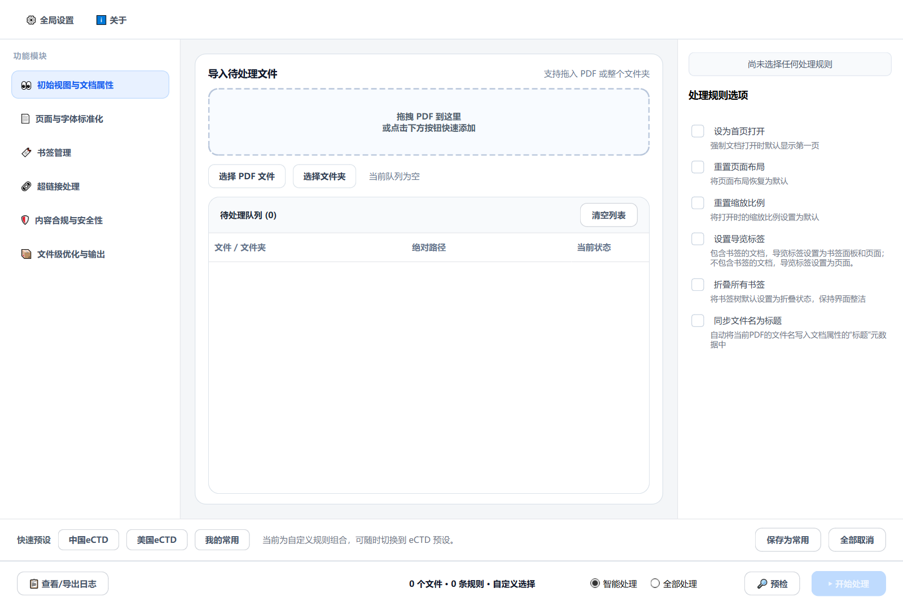

# 认识主窗口

[返回手册首页](index.md)

主窗口围绕“待处理文件”和“处理规则”组织。勾选规则不会立即改文件；执行批处理或独立工具才进入相应操作。

上图是仓库已有的较早版本截图，用于理解区域关系。当前源码增加了顶部“安全中心”、主题切换、规则页操作和“配置管理”菜单，部分按钮名称与图中不同；以下表格使用当前名称。

## 各区域的用途

| 区域 | 入口 | 用途 |
| --- | --- | --- |
| 顶部工具区 | 安全中心 | 独立进行加密、解密和权限操作 |
| 顶部工具区 | 全局设置 | 外观、默认保存位置、覆盖原件、并行、超时 |
| 顶部工具区 | 关于 | 查看版本和许可信息；标准版提供检查更新 |
| 顶部工具区 | 深色 / 浅色 | 快速切换主题；跟随系统在全局设置中选择 |
| 左侧 | 七个功能模块 | 切换右侧规则页，不会清除其他页已选规则 |
| 中间 | 文件 / 文件夹 / 清空 | 添加和整理待处理队列 |
| 右侧 | 规则、全选本页、清空 | 配置当前模块；部分页面还有独立工具按钮 |
| 快速预设栏 | 中国eCTD / 美国eCTD / 我的常用 | 应用一组规则和对应配置 |
| 快速预设栏 | 全部取消 | 取消所有已选规则，不清空文件队列 |
| 快速预设栏 | 配置管理 | 保存为我的常用、导入 JSON、导出 JSON |
| 底部 | 智能处理 / 全部处理 | 决定是否利用预检筛选已勾选规则 |
| 底部 | 预检 / 应用建议 / 处理建议文件 | 只读检查、勾选建议规则、筛选本次处理文件 |
| 底部 | 开始处理、跳过、重试失败项 | 执行及控制批次；可用状态随任务变化 |
| 底部 | 日志 | 查看记录、导出日志、预检结果和最近批次审计包 |

## 七个功能模块

依次为“初始视图与文档属性”“页面与字体标准化”“书签管理”“超链接处理”“内容合规与安全性”“文件级优化与输出”“文档检测”。最后一页为只读检测按钮，没有待执行的规则复选框。

各页的选中数量及底部规则总数帮助你发现其他页面仍然启用的规则。压缩档位会组合多个底层规则，因此总数不一定等于肉眼看到的勾选框数量。

## 本页全选与清空

“全选本页”会考虑部分冲突组合，不保证选中页面上的每个项目；它也不会自动选中“移除全部链接和书签”。文件优化页会使用压缩组合，图像降采样仍需单独检查。不要把本页全选当成适用于所有文档的推荐方案。

右侧“清空”取消当前模块规则；快速预设栏“全部取消”取消全部规则；中间队列的“清空”移除所有待处理文件。这三处作用范围不同。

## 选中文件有什么作用

右键菜单中的文件定位、详情和安全中心，以及“嵌入缺失字体”等操作会使用选中项。主窗口“开始处理”、预检、文档检测和书签/链接数据向导使用队列范围；“处理建议文件”和“重试失败项”才是专门的批处理子集入口。

文件队列的具体行为见[文件与保存规则](files-and-output.md)。若按钮灰色，先查看提示并确认是否已有任务运行、队列是否为空、是否至少选择一条处理规则。

## 当前没有开放的入口

页面工作台、图层套印、深度诊断不是当前普通界面的可用功能，也没有用户开启开关。文档检测页的两个只读检查按钮不等于深度诊断工作台。可见能力边界见[能力矩阵](../capabilities.md)。

## 全局设置怎样使用

点击顶部“全局设置”，在窗口中按需调整，再点击“确 定”。这些是本机选项，导出处理配置 JSON 时不会一并携带。

| 设置 | 操作与含义 |
| --- | --- |
| 外观主题 | 选择“跟随系统”“亮色”或“暗色”；顶部按钮用于快速切换浅/深色 |
| 默认保存位置 | 点击“浏览...”选择目录；“清除”只清空这项路径设置，不删除目录或文件。此位置用于后续选择输出和导出日志的初始目录 |
| 处理完成后自动打开输出文件夹 | 控制主批处理结束后是否打开结果目录；不代表结果已经人工复核 |
| 覆盖原始文件 (不推荐) | 将主批处理切换为写回原件；默认关闭，执行前另有风险确认 |
| 启用并行处理 / 并行数量 | 设置并行上限，实际数量仍由资源条件决定 |
| 每文件超时 | 0 为关闭，1–86400 秒；按本轮启动时设置计时 |

默认目录状态会提示路径是否存在。它不会自动替代安全中心和数据导入向导各自的结果位置。并行与超时的详细影响见[执行批处理](processing.md)。
